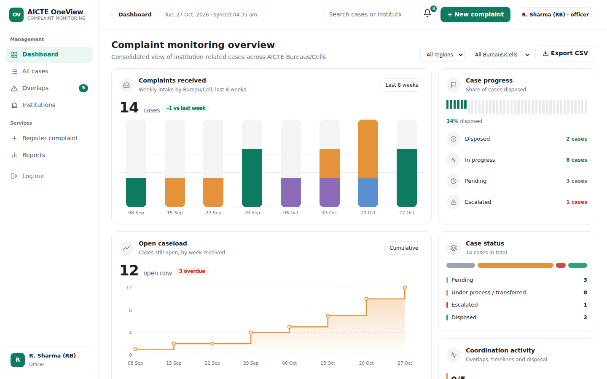

# AICTE OneView (SIH 2026, PS 26264) - core prototype

FastAPI + SQLite backend with a dashboard front end. **All data is synthetic sample data; nothing is connected to AICTE systems.**



**Quick start:** double-click `run.bat` (Windows) or run `./run.sh` (Mac/Linux), then open http://localhost:8000.

## Run in VS Code
```bash
cd backend
python -m venv .venv
.venv\Scripts\activate          # Windows   (Mac/Linux: source .venv/bin/activate)
pip install -r requirements.txt
uvicorn main:app --reload
```
Open http://localhost:8000 (dashboard) or http://localhost:8000/docs (API docs).
Delete `backend/oneview.db` to reset the sample data. Set `ONEVIEW_SECRET` before any real use.

## Demo logins (password `demo123`)
`admin` (all actions) · `rb_officer`, `pgrc_officer`, `approval_officer` (act on own Bureau's cases) · `senior_mgmt`, `regional_south` (read-only)

## What is built
Login with roles, case and institution APIs, search and filters, overlap detection (Permanent ID, then normalised names) with officer verification, transfer / escalate / dispose actions, append-only action history, SLA flags, reports, CSV export.

## Not built yet
Email/in-app notifications, document upload, monthly/quarterly report generation, PDF/Excel export, import from existing AICTE systems, PostgreSQL migration, AI text similarity.

## Stack (as built)
Frontend: plain HTML/CSS/JavaScript with SVG charts. Backend: Python FastAPI. Database: SQLite (PostgreSQL planned). The idea deck `AICTE-OneView-SIH2026-Idea.pptx` describes this stack.

## Before submitting
Fill in Team ID, team name, demo video link and GitHub link in the deck (slides 1 and 6).
