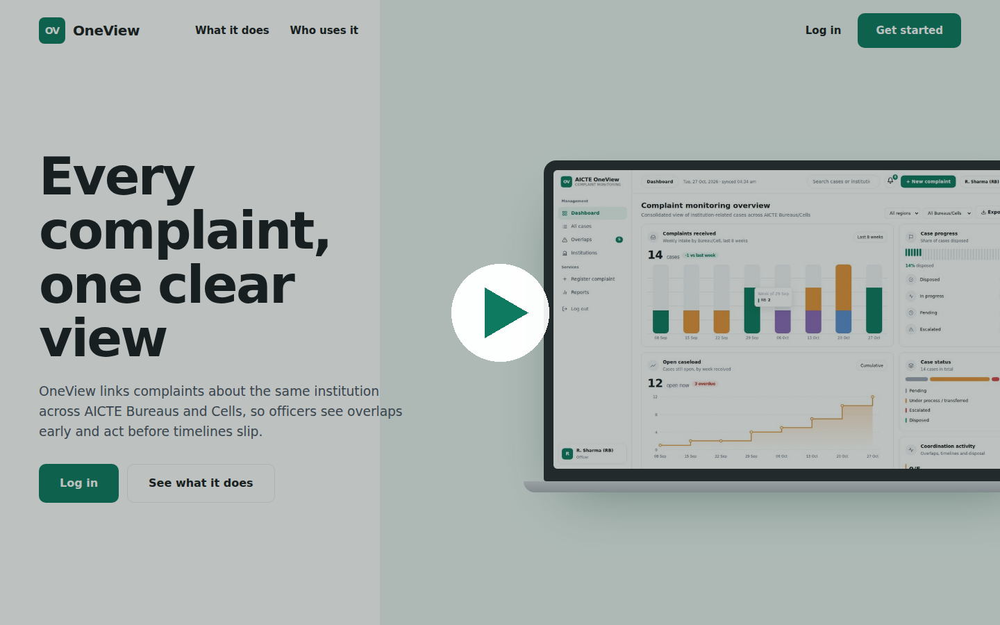

# AICTE OneView

### One Institution. Every Complaint. One Coordinated View.

An integrated dashboard that links complaints about the same institution across AICTE Bureaus and Cells, so officers see overlaps early, coordinate their action, and resolve cases on time.

| | |
|---|---|
| **Hackathon** | Smart India Hackathon 2026 |
| **Problem Statement ID** | 26264 |
| **Problem Statement** | Integrated Dashboard for Monitoring and Tracking Institution-Related Complaint Cases Across AICTE Bureaus/Cells |
| **Theme** | Smart Automation |
| **Category** | Software |
| **Team** | TEAM-NIXORA (Team ID 197811) |
| **Demo video** | [Watch on YouTube](https://youtu.be/Rti1cLXVlZo) |

> **All data in this project is synthetic sample data. Nothing is connected to, or approved by, AICTE systems.** This repository is a working prototype of the idea, not a deployed product.

## Demo video

[](https://youtu.be/Rti1cLXVlZo)

> Click the image above to watch the demo on YouTube: the problem, our solution, and the working prototype.

---

## Contents

1. [The problem](#1-the-problem)
2. [Our solution](#2-our-solution)
3. [Key innovations](#3-key-innovations)
4. [How it works](#4-how-it-works)
5. [What the prototype includes](#5-what-the-prototype-includes)
6. [Run it yourself](#6-run-it-yourself)
7. [Demo logins and roles](#7-demo-logins-and-roles)
8. [Technology](#8-technology)
9. [Feasibility, risks and roadmap](#9-feasibility-risks-and-roadmap)
10. [Impact and how we would measure it](#10-impact-and-how-we-would-measure-it)
11. [API overview](#11-api-overview)
12. [What is not built yet](#12-what-is-not-built-yet)
13. [References](#13-references)

---

## 1. The problem

Complaints about an institution reach several AICTE Bureaus and Cells, including the Regulation Bureau (RB) and the Public Grievance Redressal Cell (PGRC). Cases about the *same* institution can be handled by different units, each working from its own records.

As a result:

- No single, real-time view of an institution's cases exists.
- Different Bureaus can take duplicate or conflicting action on the same institution.
- Coordination between Bureaus is manual.
- Follow-ups are delayed, and action records are scattered.

The problem statement asks for a single-window dashboard with overlap detection, alerts and reports.

## 2. Our solution

OneView gives every institution one profile, built on its **AICTE Permanent ID**, and puts all its complaints into a **unified case registry**. For each case, authorised officers see:

- the current Bureau/Cell and officer,
- status and a full action history,
- the next action and the expected disposal date,
- other complaints linked to the same institution.

The system flags **potential overlaps** between Bureaus, warns officers before timelines are missed, and produces periodic reports.

**Potential matches always need an officer's verification. They are never treated as confirmed duplicates.**

## 3. Key innovations

| Innovation | What it means |
|---|---|
| **AICTE Permanent ID profile** | One institution identity across all Bureaus and Cells |
| **Unified case registry** | Every complaint, officer, status and action in one place |
| **Potential overlap detection** | Rule-based matching, with an officer verifying every match |
| **Coordinated action** | Link related cases and notify the other Bureaus in one step |

**How matching works**

1. **AICTE Permanent ID.** A deterministic match.
2. **Normalised institution name and complaint details.** A rule-based match, used when the ID is missing or differs.
3. **Optional AI text similarity.** Proposed, not built. It would be probabilistic and always flagged as a potential match.

## 4. How it works

```
 Complaint intake  →  Institution ID matching  →  Overlap detection
        ↓                                                ↓
 Alerts and reports  ←  Action and timeline tracking  ←  Bureau / officer assignment
```

1. **Complaint intake.** The case is logged with institution details and category.
2. **Institution ID matching.** The case is resolved to the institution's AICTE Permanent ID.
3. **Overlap detection.** Potential overlaps across Bureaus/Cells are flagged.
4. **Assignment.** An officer reviews the case and coordinates with other Bureaus.
5. **Action and timeline tracking.** Status, next action, disposal or escalation are recorded.
6. **Alerts and reports.** Dashboards, overdue and due-soon alerts, and periodic reports.

## 5. What the prototype includes

- **Landing page and login.** A first page that leads to a separate sign-in screen.
- **Dashboard.** Weekly intake by Bureau, open caseload, case status, ageing, regional view, and a needs-attention list of escalated and overdue cases.
- **All cases.** Search by institution, AICTE ID or case ID. Filter by Bureau, region, category, status and age. Overlap tags and CSV export.
- **Overlaps.** Potential overlap groups per institution, showing which rule matched. Officers can link cases and notify the other Bureaus, or mark a match as not related.
- **Case detail.** Institution details, next action, expected disposal date and a chronological, append-only action history.
- **Case actions.** Register, transfer, escalate and dispose of cases. Each action is saved to the history.
- **Documents.** Attach PDF, image, Word, Excel or text files (up to 5 MB) to a case. Attachments are logged in the history.
- **Institutions.** Every institution with all its cases in one place.
- **Reports and export.** Monthly and quarterly reports as Excel or PDF, a full case export to Excel and CSV.
- **Alerts.** In-app overdue, due-soon and overlap alerts.
- **Role-based access.** Officers act only on their own Bureau's cases. Senior management and regional offices have read-only views.

## 6. Run it yourself

You need Python 3.9 or newer.

**Windows:** double-click `run.bat`.
**Mac / Linux:** run `./run.sh`.

Then open **http://localhost:8000**. The first run installs what it needs and takes about a minute.

### Run it manually (for example in VS Code)

```bash
cd backend
python -m venv .venv
.venv\Scripts\activate          # Mac/Linux: source .venv/bin/activate
pip install -r requirements.txt
uvicorn main:app --reload
```

Open http://localhost:8000 for the app, or http://localhost:8000/docs for the interactive API documentation.

### Reset the sample data

Stop the server, delete `backend/oneview.db`, and start it again.

## 7. Demo logins and roles

Password for every account: `demo123`

| Username | Role | Can do |
|---|---|---|
| `admin` | Admin | Everything |
| `rb_officer` | Officer, RB | Act on RB cases |
| `pgrc_officer` | Officer, PGRC | Act on PGRC cases |
| `approval_officer` | Officer, Approval Bureau | Act on Approval Bureau cases |
| `senior_mgmt` | Senior management | View all Bureaus (read-only) |
| `regional_south` | Regional office | View the Southern region (read-only) |

**A suggested walkthrough:** sign in as `rb_officer`, open the Dashboard, then Overlaps, open a case from the All cases page, and finish on Reports.

## 8. Technology

The prototype and the full proposal use different stacks. We kept the prototype simple so it runs with one click.

| Layer | Prototype (this repository) | Proposed for a full system |
|---|---|---|
| Frontend | Plain HTML, CSS and JavaScript, SVG charts | React, role-based responsive UI |
| Backend | Python, FastAPI | FastAPI or Django REST |
| Database | SQLite | PostgreSQL |
| Matching | Rule-based (Permanent ID, normalised names) | Rule-based, plus optional NLP or embeddings |
| Reports | openpyxl (Excel), reportlab (PDF) | Scheduled report generation |
| Security | Signed tokens, PBKDF2 password hashing, role checks, append-only history | Encryption, least-privilege access, audit logs, secure document storage |

```
oneview/
├── backend/
│   ├── main.py            API, matching logic, reports, uploads, sample data
│   └── requirements.txt
├── frontend/
│   ├── index.html         Landing page, login and dashboard (single file)
│   └── hero-dashboard.jpg Image used on the landing page
├── docs/                  Demo video thumbnail used in this README
├── run.bat                One-click start (Windows)
└── run.sh                 One-click start (Mac / Linux)
```

## 9. Feasibility, risks and roadmap

**Feasibility**

- **Technical:** standard web technologies and a relational database.
- **Operational:** a shared registry with role-specific views for RB, PGRC and other authorised units.
- **Security:** least-privilege permissions, encryption and audit trails.
- **Scalability:** modular APIs and phased onboarding of Bureaus and Cells.

**Risks and how we address them**

| Risk | Mitigation |
|---|---|
| Inconsistent institution records | Master institution ID and data validation |
| False-positive overlap alerts | An officer reviews every potential match |
| Legacy-system integration | Phased imports and APIs |
| Sensitive case data | Role-based access and audit logging |

**Roadmap**

1. **Registry MVP.** Requirements, data mapping and the registry.
2. **Dashboard and search.** Unified dashboard, filters and history.
3. **Overlap alerts.** Matching rules and alerts.
4. **Pilot and rollout.** An RB and PGRC pilot, evaluation, then wider rollout.

Implementation depends on access to authorised AICTE data and existing systems. No integration has been completed.

## 10. Impact and how we would measure it

**Target users:** the AICTE Regulation Bureau, PGRC, other Bureaus and Cells, Regional Offices, authorised officers and senior management.

| Today | With OneView |
|---|---|
| Fragmented case visibility | A unified institution view |
| Manual cross-bureau coordination | Overlap alerts |
| Delayed follow-up | Timeline reminders |
| Dispersed action records | A chronological audit history |

**Expected benefits:** better coordination, stronger accountability and more timely grievance handling, with less duplicated effort.

**Pilot measures:** duplicate handling rate, overdue-case rate, time to identify overlapping cases, and the share of cases with an updated next action. Baselines would be measured in the pilot. **We do not claim any improvement figures.**

## 11. API overview

All endpoints except login need the token returned by `POST /api/login`. Full details are at `/docs` while the server is running.

| Method | Endpoint | Purpose |
|---|---|---|
| POST | `/api/login` | Sign in and get a token |
| GET | `/api/cases` | List cases, with search and filters |
| GET | `/api/cases/{id}` | Case detail and history |
| POST | `/api/cases` | Register a complaint |
| POST | `/api/cases/{id}/actions` | Transfer, escalate or dispose |
| GET / POST | `/api/cases/{id}/documents` | List or attach documents |
| GET | `/api/documents/{id}` | Download a document |
| GET | `/api/institutions` | Institutions and their cases |
| GET | `/api/match` | Check a name or Permanent ID against existing cases |
| GET | `/api/overlaps` | Potential overlap groups |
| POST | `/api/overlaps/{institution}` | Link cases or mark not related |
| GET | `/api/alerts` | Overdue and due-soon cases |
| GET | `/api/stats` | Dashboard figures |
| GET | `/api/reports/{dimension}` | Reports by Bureau, region and more |
| GET | `/api/report-file` | Monthly or quarterly report (`period`: monthly, quarterly; `fmt`: xlsx, pdf) |
| GET | `/api/export.csv` | CSV export |
| GET | `/api/export.xlsx` | Excel export of all cases |

## 12. What is not built yet

- Email notifications (the bell shows in-app alerts only)
- Import from existing AICTE systems, which needs access to authorised data
- PostgreSQL migration
- AI-based text similarity (matching today is rule-based)
- React frontend (the prototype uses plain JavaScript)
- Encryption at rest and secure document storage

## 13. References

- **Primary source:** AICTE, Problem Statement 26264, *Integrated Dashboard for Monitoring and Tracking Institution-Related Complaint Cases Across AICTE Bureaus/Cells* (Smart India Hackathon, supplied problem statement).
- AICTE official website: https://www.aicte-india.org/
- FastAPI documentation: https://fastapi.tiangolo.com/
- PostgreSQL documentation: https://www.postgresql.org/docs/
- React documentation: https://react.dev/

The design choices above are our proposal, not research findings. They have not been integrated with or approved by AICTE.

## Security note

This is a prototype. Set the `ONEVIEW_SECRET` environment variable to a long random value before any real use, and replace the demo accounts and passwords.
