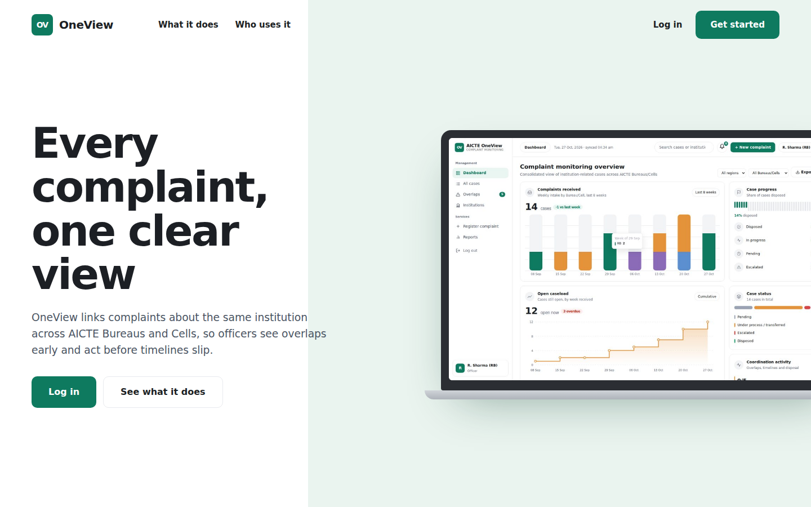

# AICTE OneView

**One view of every complaint about an institution, across all AICTE Bureaus and Cells.**

Built for Smart India Hackathon 2026 (Problem Statement 26264). OneView links complaints about the same institution that were filed with different Bureaus, so officers see overlaps early, coordinate, and act before timelines slip.

> **All data in this project is synthetic sample data. Nothing is connected to AICTE systems.**



## The problem

The same institution can have complaints open with several Bureaus at once, such as RB, PGRC and the Approval Bureau. Each Bureau works from its own records, so nobody sees the full picture. Cases overlap, timelines slip, and the institution may receive conflicting notices.

## What OneView does

- **Overlap detection.** Cases are matched by AICTE Permanent ID first, then by normalised institution name. Matches are shown as *potential* overlaps for an officer to verify, never as confirmed duplicates.
- **Officer verification.** An officer links related cases and notifies the other Bureaus in one step, or marks the match as not related.
- **Case actions.** Register, transfer, escalate and dispose of cases. Every action is saved in an append-only history on the case.
- **Timeline tracking.** Expected disposal dates, SLA flags, overdue and due-soon alerts, and an ageing view.
- **Dashboard.** Weekly intake by Bureau, open caseload, status split, regional view and a needs-attention list.
- **Documents.** Officers attach files (PDF, image, Word, Excel, text, up to 5 MB) to a case. Attachments are logged in the case history.
- **Reports and export.** Monthly and quarterly reports as Excel or PDF, a full case export to Excel and CSV, plus filters by Bureau, region, category, status and age.
- **Roles.** Officers act only on their own Bureau's cases. Senior management and regional offices have read-only views.

## Quick start

You need Python 3.9 or newer.

**Windows:** double-click `run.bat`.
**Mac / Linux:** run `./run.sh`.

Then open **http://localhost:8000**. The first run installs what it needs and takes about a minute.

### Run it manually (for example in VS Code)

```bash
cd backend
python -m venv .venv
.venv\Scripts\activate          # Mac/Linux: source .venv/bin/activate
pip install -r requirements.txt
uvicorn main:app --reload
```

Open http://localhost:8000 for the app, or http://localhost:8000/docs for the interactive API docs.

### Reset the sample data

Stop the server, delete `backend/oneview.db`, and start it again.

## Demo logins

Password for every account: `demo123`

| Username | Role | Can do |
|---|---|---|
| `admin` | Admin | Everything |
| `rb_officer` | Officer, RB | Act on RB cases |
| `pgrc_officer` | Officer, PGRC | Act on PGRC cases |
| `approval_officer` | Officer, Approval Bureau | Act on Approval Bureau cases |
| `senior_mgmt` | Senior management | View all Bureaus (read-only) |
| `regional_south` | Regional office | View Southern region (read-only) |

## How it is built

| Part | Technology |
|---|---|
| Frontend | Plain HTML, CSS and JavaScript, with SVG charts. No build step. |
| Backend | Python, FastAPI, openpyxl (Excel), reportlab (PDF) |
| Database | SQLite (PostgreSQL is the planned next step) |
| Auth | Signed tokens, PBKDF2 password hashing |

```
oneview/
├── backend/
│   ├── main.py            API, matching logic, reports, uploads, sample data
│   └── requirements.txt
├── frontend/
│   ├── index.html         Landing page, login and dashboard (single file)
│   └── hero-dashboard.jpg Image used on the landing page
├── docs/                  Landing page screenshot used in this README
├── run.bat                One-click start (Windows)
└── run.sh                 One-click start (Mac / Linux)
```

## API overview

All endpoints except login need the token returned by `POST /api/login`. Full details are at `/docs` while the server is running.

| Method | Endpoint | Purpose |
|---|---|---|
| POST | `/api/login` | Sign in and get a token |
| GET | `/api/cases` | List cases, with search and filters |
| GET | `/api/cases/{id}` | Case detail and history |
| POST | `/api/cases` | Register a complaint |
| POST | `/api/cases/{id}/actions` | Transfer, escalate or dispose |
| GET | `/api/institutions` | Institutions and their cases |
| GET | `/api/match` | Check a name or Permanent ID against existing cases |
| GET | `/api/overlaps` | Potential overlap groups |
| POST | `/api/overlaps/{institution}` | Link cases or mark not related |
| GET | `/api/alerts` | Overdue and due-soon cases |
| GET | `/api/stats` | Dashboard figures |
| GET | `/api/reports/{dimension}` | Reports by Bureau, region and more |
| GET | `/api/export.csv` | CSV export |
| GET | `/api/export.xlsx` | Excel export of all cases |
| GET | `/api/report-file?period=monthly&fmt=pdf` | Monthly or quarterly report (`period`: monthly, quarterly; `fmt`: xlsx, pdf) |
| GET / POST | `/api/cases/{id}/documents` | List or attach documents |
| GET | `/api/documents/{id}` | Download a document |

## Not built yet

- Email notifications (the bell shows in-app overdue and overlap alerts)
- Import from existing AICTE systems (needs access to those systems)
- PostgreSQL migration
- AI-based text similarity (matching today is rule-based)

## Security note

This is a prototype. Set the `ONEVIEW_SECRET` environment variable to a long random value before any real use, and replace the demo accounts and passwords.
